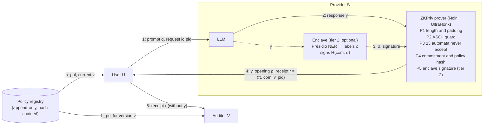
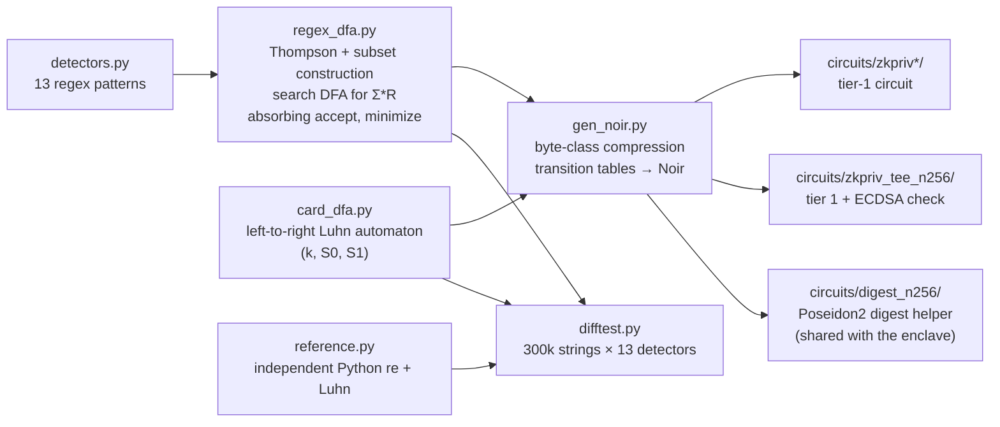

# ZKPriv

**Zero-knowledge proofs that an LLM response contains no prohibited personal data.**

A cloud LLM provider attaches a receipt to every response. The receipt is a zero-knowledge proof that the response contains no personally identifiable information (PII) forbidden by the provider's registered policy. It reveals nothing about the prompt, the response or the model. Detection runs **inside the circuit**, so the provider cannot skip the filter or lie about its output: if the response contains PII, there is no proof.

> Paper: *ZKPriv: Zero-Knowledge Proofs That LLM Responses Contain No Prohibited Personal Data*, H. Khan, G. Mahdian, A. Jalooli (CSU Dominguez Hills). Submitted to IEEE ICNC 2027. ZKPriv is the output-side companion to [SenseCLLM](#related-work-from-our-group), which protects prompts at the edge.

---

## Contents

1. [What it guarantees](#what-it-guarantees)
2. [Software architecture](#software-architecture)
3. [Repository layout](#repository-layout)
4. [Results](#results)
5. [Setup](#setup)
6. [Reproducing the paper](#reproducing-the-paper)
7. [Changes in v2](#changes-in-v2)
8. [Remaining work](#remaining-work)

---

## What it guarantees

| Tier | Covers | How | Trust needed |
|---|---|---|---|
| **1: structured PII** | SSN, e-mail (including `name AT host DOT com`), US and international phone numbers, IPv4, numeric and written dates, dates of birth, payment cards (Luhn-checked), account numbers, prefixed IDs (passport, MRN, account), IBAN | 13 detectors compiled to minimized search automata and run over every committed byte **inside the circuit** | None beyond the proof system and Poseidon2 |
| **2: semantic PII** (optional) | Names, places, nationality/religion/politics, other identifiers | An enclave runs NER (Presidio + spaCy) and signs `H(com, labels)` with secp256k1; the circuit verifies the signature | Enclave attestation. A compromised enclave can under-label tier 2 but cannot weaken tier 1 |

**Threats handled** (malicious provider):

| ID | Attack | Defence |
|---|---|---|
| A1 | False certification: deliver PII with a valid receipt | Proof soundness, plus the user's commitment check |
| A2 | Policy downgrade to an older, weaker policy | Policy hash and version bound in the proof; registry head check |
| A3 | Replay a receipt for another request | Request id `pid` bound into the commitment |
| A4 | Hide PII after the declared length | Circuit forces zero padding and binds the length |
| A5 | Forge or reuse tier-2 labels | Enclave signature over a digest that contains the commitment |

**Not covered:** PII that no detector expresses (digits spelled as words, base64), leakage spread across many queries, and side channels.

---

## Software architecture

### Request-time data flow



The user recomputes `com` from `y` and `ρ`, checks the policy version against the registry, and verifies `π`. An auditor verifies a forwarded receipt without ever seeing `y`. If `y` contains forbidden PII, witness generation fails and no `π` exists.

### Build-time pipeline: detectors to circuit



### Components

| Component | Path | Role |
|---|---|---|
| Regex compiler | `circuits/gen/regex_dfa.py` | Compiles a small regex dialect to a minimized search DFA over bytes. Accepting states are absorbing, so "never matched" is a single check on the final state. |
| Detector set | `circuits/gen/detectors.py` | The 13 patterns, with explicit non-alphanumeric boundaries and a virtual boundary byte at both ends. |
| Luhn automaton | `circuits/gen/card_dfa.py` | Tracks both Luhn sums left to right (`S0' = d + S1`, `S1' = dbl(d) + S0`) for 12–19-digit cards, optionally grouped by spaces or hyphens. |
| Circuit generator | `circuits/gen/gen_noir.py` | Emits Noir source: byte-class maps, transition tables, a Poseidon2 sponge commitment, the policy hash, and optionally ECDSA (`--tee`) or the digest helper (`--helper`). Accepts a detector subset for variants. |
| Prover driver | `prover/run.py`, `prover/run_tee.py` | Writes `Prover.toml`, runs `nargo execute`, `bb prove`, `bb write_vk` (cached) and `bb verify`. Reports timings, proof size and peak memory. |
| Enclave (simulated) | `tee-sim/enclave.py` | Presidio NER, the label mask, the digest from the helper circuit, and a low-S secp256k1 signature. The code and keys are real; hardware attestation is not reproduced. |
| Evaluation | `eval/` | Differential and circuit agreement tests, tier-2 forgery tests, the held-out comparison with four baselines, and the real-LLM study. |
| Paper pipeline | `scripts/make_macros.py`, `scripts/make_figures.py` | Turn `eval/results/*.json` into `paper/numbers.tex` and `paper/figs/*.pdf`. The paper contains no hand-typed measurements. |

### Policy mask

| Bits | Meaning |
|---|---|
| 0–12 | Detectors: ssn, email, phone_us, ipv4, date, card, date_text, phone_intl, dob, longnum, id_prefixed, iban, email_obf |
| 13 | ASCII guard: rejects Unicode digits and look-alike characters |
| 14–17 | Tier-2 categories: PERSON, LOCATION, NRP, OTHER_ID |

The **standard** policy blocks birth dates only (bits 4 and 6 cleared). The **strict** policy blocks every date, following HIPAA Safe Harbor. The strict circuit omits the birth-date detector because the generic date detectors already cover it; detection is identical on both test sets.

---

## Repository layout

```
circuits/
  gen/                 regex → DFA compiler, detectors, Luhn DFA, Noir generator, differential test
  zkpriv/              generated tier-1 circuit (N = 256)
  zkpriv_tee_n256/     generated tier-1 + tier-2 circuit
  digest_n256/         Poseidon2 digest helper used by the enclave
  variants/            generated per-size / per-detector circuits (git-ignored)
prover/                proving and verification drivers
tee-sim/               simulated enclave (NER + signing)
eval/
  data/                development and held-out test sets, generators
  results/             every measured number, as JSON
  *.py                 agreement, soundness, comparison, LLM studies
scripts/               benchmarks, macro and figure generation
paper/                 LaTeX source (IEEEtran), numbers.tex, figures
docs/                  design notes and related-work survey
```

---

## Results

All numbers come from `eval/results/`. They were measured on an Apple M4 Pro CPU (24 GB), as the median of 10 runs.

**R1: correct and unforgeable**

| Check | Result |
|---|---|
| 13 automata vs. independent `re`/Luhn references, 300k random and pattern-seeded strings (64,747 matches) | 3.9 M / 3.9 M agree |
| Generated Noir circuit vs. references (witness generation) | 300 / 300 agree |
| Tier-2 forgeries (zeroed labels, flipped signature bit, other key, reused attestation) | 4 / 4 refused |

**R2: cost**, ZK UltraHonk, N = 256 bytes

| Circuit | Gates | Prove | Verify | Proof | Peak memory |
|---|---|---|---|---|---|
| Strict (12 detectors) | 221,744 | **0.87 s** | 12 ms | 14.3 KiB | 450 MiB |
| Standard (13 detectors) | 562,391 | 2.62 s | 19 ms | 14.3 KiB | 1,155 MiB |
| Standard + tier 2 | 600,377 | 3.51 s | 22 ms | 14.3 KiB | 1,112 MiB |

A 1 KB response proves in 1.31 s under the strict policy. The birth-date detector accounts for 69% of the standard circuit. Proving takes less time than generating the response; the median Llama 3.1 8B response took 4.7 s.

**R3: held-out detection of structured PII** (500 + 500 records, frozen before tuning)

| System | Recall, ai4privacy | Recall, synthetic | Over-blocking, ai4privacy | Over-blocking, synthetic |
|---|---|---|---|---|
| **ZKPriv (strict)** | **0.955** | **1.000** | **33.6%** | 15.0% |
| Presidio | 0.855 | 0.975 | 81.8% | 92.6% |
| Presidio, pattern recognizers only | 0.724 | 0.871 | 36.8% | 0.0% |
| spaCy NER | 0.290 | 0.301 | | |
| LLM detector (llama3.2:3b) | 0.208 | 0.679 | | |

ZKPriv's standard policy reaches 0.985 recall with 0% over-blocking on the synthetic set. Presidio is stronger on non-US tax numbers and on IDs with trailing letters; the paper's Table II gives per-category results.

**R4: real LLM outputs** (50 held-out records per model, 4 prompts each)

| Model | Leaking responses | Refused | Benign refused |
|---|---|---|---|
| Qwen 2.5 7B | 144 | 144 | 0 / 50 |
| Llama 3.1 8B | 26 | 26 | 0 / 50 |
| Llama 3.2 3B | 8 | 8 | 0 / 50 |
| **Total** | **178** | **178** | **0 / 150** |

All 756 of the 756 leaked values were caught.

---

## Setup

**Proof toolchain** (pinned):

```bash
noirup -v 1.0.0-beta.22
bbup -nv 1.0.0-beta.22        # installs bb 5.0.0-nightly.20260522
```

**Python 3.11+:**
- `cryptography` for the enclave.
- `presidio-analyzer`, `spacy` and `en_core_web_sm` for tier 2 and the baselines.
- `faker` for the synthetic data.
- `matplotlib` for the figures.
- [Ollama](https://ollama.com) for the LLM studies, with `llama3.2:3b`, `llama3.1:8b` and `qwen2.5:7b`.

Scripts that need Presidio note this in their docstring.

---

## Reproducing the paper

```bash
# 1. Generate circuits
python3 circuits/gen/gen_noir.py               # tier-1 circuit, N = 256
python3 circuits/gen/gen_noir.py 256 --tee     # tier 1 + tier 2
python3 circuits/gen/gen_noir.py 256 --helper  # digest helper for the enclave

# 2. Prove one response (fails, with no proof, if the text contains PII)
python3 prover/run.py "Thanks, your order has shipped."
python3 prover/run_tee.py "Thanks, your order has shipped."

# 3. R1: correctness and forgery checks
python3 circuits/gen/difftest.py 300000   # -> eval/results/difftest.json
python3 eval/circuit_agreement.py 300
python3 eval/tee_soundness.py

# 4. R2: cost
python3 scripts/bench.py            # standard circuit: scaling, gate breakdown, throughput
python3 scripts/bench_strict.py     # strict circuit across response sizes
python3 scripts/bench_tee.py        # tier-2 cost

# 5. R3: held-out comparison (baselines included)
python3 eval/llm_baseline.py test   # LLM detector baseline, cached
python3 eval/compare.py test

# 6. R4: real LLM outputs
python3 eval/llm_outputs.py --n 50 --model qwen2.5:7b  --data synth_test_500 --out llm_outputs_qwen25_7b.json
python3 eval/llm_outputs.py --n 50 --model llama3.1:8b --data synth_test_500 --out llm_outputs_llama31_8b.json
python3 eval/llm_outputs.py --n 50 --model llama3.2:3b --data synth_test_500 --out llm_outputs_llama32_3b.json

# 7. Paper
python3 scripts/make_macros.py && python3 scripts/make_figures.py
cd paper && pdflatex paper && bibtex paper && pdflatex paper && pdflatex paper
```

**Data.**
- The development set is `eval/data/ai4privacy_500.json` (ai4privacy train split) plus `synth_500.json`.
- The held-out test set is `ai4privacy_test_500.json` (validation split, seed 2027) plus `synth_test_500.json` (new seed). It was committed before any detector tuning; `eval/data/make_heldout.py` rebuilds it.

---

## Changes in v2

v1 of ZKPriv simulated its proofs and took PII labels as a free witness, so a dishonest prover could label everything "not sensitive". v2 is a full rebuild:

- **Detection is inside the circuit.** It covers 13 compiled search automata, including a left-to-right Luhn automaton, a dob detector (date within 20 characters of a cue), written dates, international phones, obfuscated e-mail, IBAN, prefixed IDs and long account numbers.
- **The proofs are real.** They use Noir with zero-knowledge UltraHonk; ZK is confirmed by proof size (14,656 B vs. 13,120 B for non-ZK).
- **Receipts are policy-bound.** A Poseidon2 commitment covers the response, its length and padding, the request id, and a versioned policy hash checked against a hash-chained registry.
- **Tier 2 is new.** Enclave-signed NER labels are verified in the circuit with secp256k1 ECDSA; a digest helper circuit guarantees the enclave hashes exactly as the circuit does.
- **A strict-policy circuit** gives sub-second proofs: 0.87 s at 256 B and 1.31 s at 1 KB.
- **The evaluation is honest.**
  - Held-out test sets were frozen before tuning.
  - One span-overlap protocol with over-blocking applies to every system.
  - Wilson confidence intervals are reported.
  - There are four baselines.
  - A real-LLM study covers three models.
- **The paper is generated from the results.** Every number in `paper/` is a macro from `scripts/make_macros.py`. The figures follow one visual per result: Table I, Fig. 2 (line), Fig. 3 (bars), Table II (per category) and Table III (per model). All 29 references were verified against their publishers.
- **Bugs found by differential testing and fixed:**
  - a card followed by text was missed;
  - dotted SSNs were missed;
  - an e-mail at the end of a sentence was missed;
  - 12-digit Maestro cards were missed;
  - control-character escapes inside regex character classes were mis-parsed.

---

## Remaining work

**Before submission (ICNC 2027, deadline 18 Oct 2026):**
- [ ] Co-author review (G. Mahdian, A. Jalooli) and confirmation of author e-mails
- [ ] Upload to Overleaf; final IEEE PDF eXpress check
- [ ] Make this repository public, or provide an anonymized link if reviewing is double-blind, and add the URL to the paper

**Research follow-ups:**
- [ ] Run tier 2 on attested hardware (Intel TDX or an H100 confidential VM) instead of the simulator
- [ ] Use a stronger NER model for tier 2; names are currently the weakest category (0.54 recall on ai4privacy)
- [ ] Add detectors for non-US tax and ID formats, which are the main recall gap against Presidio
- [ ] Chunked proofs for responses longer than N, and aggregation of receipts across queries
- [ ] Compose with an inference-correctness proof (zkLLM / zkGPT) through the shared output commitment

---

## Related work from our group

- **SenseCLLM**: H. Khan, G. Mahdian, A. Jalooli, "SenseCLLM: A Three-Agent Edge-Resident Framework for Adaptive PII Detection and Selective Anonymization in IoT-to-LLM Pipelines," *IEEE World AI IoT Congress (AIIoT)*, 2026. SenseCLLM controls what the model sees; ZKPriv certifies what it returns.

## Authors

Huzaif Khan, Ghazal Mahdian, Ali Jalooli. Department of Computer Science, California State University, Dominguez Hills.
