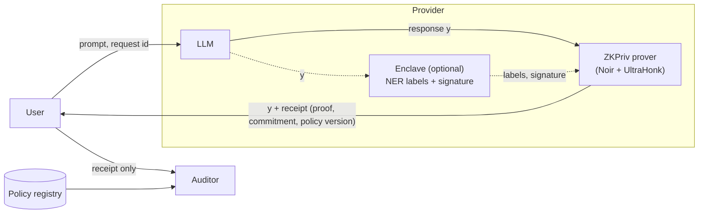
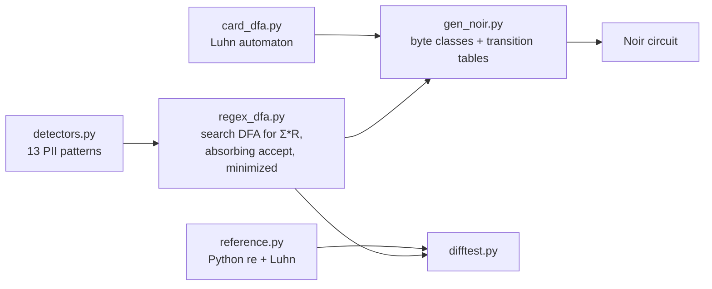

# ZKPriv

Code for **"ZKPriv: Zero-Knowledge Proofs That LLM Responses Contain No Prohibited Personal Data"**
Huzaif Khan, Ghazal Mahdian, Ali Jalooli, California State University, Dominguez Hills.

ZKPriv attaches a zero-knowledge proof to an LLM response. The proof shows that the response contains no personally identifiable information (PII) forbidden by a registered policy, without revealing the response itself. PII detection runs inside the circuit: if the response contains PII, no proof can be produced.

```
$ python3 prover/run.py "Thanks, your order has shipped and will arrive Tuesday."
{"outcome": "verified", "prove_s": 1.914, "verify_s": 0.01, "proof_bytes": 14656, ...}

$ python3 prover/run.py "Sure, the SSN on file is 123-45-6789."
{"outcome": "refused", "reason": "error: Assertion failed: policy violation: ssn"}
```

---

## How it works



The prover commits to the response with Poseidon2 and proves, in zero knowledge, that:

1. **Length and padding:** the committed bytes are the response, zero-padded to the circuit capacity N.
2. **ASCII guard:** every byte is ASCII, which blocks Unicode digits and look-alike characters.
3. **Detectors:** none of the 13 PII automata reaches its accepting state anywhere in the response.
4. **Commitment and policy:** the commitment and the policy hash are bound to the request id and the policy version.
5. **Enclave labels (tier 2, optional):** an enclave's ECDSA signature over the named-entity labels is valid, and no forbidden category is present.

The user checks the commitment against the response it received. An auditor verifies the receipt without ever seeing the response.

### From regular expressions to circuit



Each detector is compiled into a minimized DFA that recognizes Σ\*R ("R occurs somewhere"). Accepting states are absorbing, so the circuit only has to check that the final state is not accepting. Payment cards use a left-to-right automaton that tracks both Luhn sums, so it needs no lookahead.

The 13 detectors are:
- SSN;
- e-mail and obfuscated e-mail (`name AT host DOT com`);
- US and international phone numbers;
- IPv4;
- numeric and written dates;
- date of birth (a date near a cue such as "born" or "DOB");
- payment card (Luhn-checked);
- long account number;
- prefixed ID (passport, MRN, account);
- IBAN.

---

## Repository structure

```
circuits/
  gen/
    regex_dfa.py       regex → minimized search DFA over bytes
    detectors.py       the 13 detector patterns
    card_dfa.py        Luhn payment-card automaton
    gen_noir.py        emits the Noir circuit (tier 1, tier 2 with --tee, digest helper with --helper)
    reference.py       independent Python reference detectors
    difftest.py        differential test: DFAs vs. references
  zkpriv/              generated tier-1 circuit (N = 256)
  zkpriv_tee_n256/     generated tier-1 + tier-2 circuit
  digest_n256/         Poseidon2 digest helper shared with the enclave
prover/
  run.py               witness → prove → verify (tier 1)
  run_tee.py           enclave labelling + tier-2 proof
tee-sim/
  enclave.py           simulated enclave: Presidio NER, secp256k1 signing
eval/
  data/                development and held-out test sets, generators
  results/             raw results (JSON) behind every number in the paper
  compare.py           held-out comparison against baselines
  circuit_agreement.py circuit vs. reference agreement
  tee_soundness.py     tier-2 forgery tests
  llm_baseline.py      LLM-detector baseline
  llm_outputs.py       real LLM responses through ZKPriv
scripts/
  bench.py             cost of the standard circuit (scaling, gate breakdown, throughput)
  bench_strict.py      cost of the strict circuit
  bench_tee.py         cost of tier 2
  make_macros.py       results JSON → paper/numbers.tex
  make_figures.py      results JSON → paper figures
paper/                 LaTeX source of the paper
```

---

## Installation

**Proof toolchain** (pinned versions):

```bash
curl -L https://raw.githubusercontent.com/noir-lang/noirup/main/install | bash
noirup -v 1.0.0-beta.22
curl -L https://raw.githubusercontent.com/AztecProtocol/aztec-packages/master/barretenberg/bbup/install | bash
bbup -nv 1.0.0-beta.22
```

**Python 3.11+:**

```bash
pip install cryptography faker matplotlib presidio-analyzer spacy
python -m spacy download en_core_web_sm
```

The LLM experiments also need [Ollama](https://ollama.com) with `llama3.2:3b`, `llama3.1:8b` and `qwen2.5:7b`.

---

## Usage

**Generate the circuits**

```bash
python3 circuits/gen/gen_noir.py               # tier-1 circuit, N = 256
python3 circuits/gen/gen_noir.py 1024          # tier-1 circuit, N = 1024
python3 circuits/gen/gen_noir.py 256 --tee     # tier 1 + tier 2
python3 circuits/gen/gen_noir.py 256 --helper  # digest helper for the enclave
```

**Prove a response**

```bash
python3 prover/run.py "text of the LLM response" [--n 256] [--mask 16383]
python3 prover/run_tee.py "text of the LLM response"      # with enclave labels
```

The output is one JSON line: the outcome (`verified` or `refused`), witness, prove and verify times, proof size and peak memory.

The policy mask selects what is forbidden:

| Bits | Meaning |
|---|---|
| 0–12 | ssn, email, phone_us, ipv4, date, card, date_text, phone_intl, dob, longnum, id_prefixed, iban, email_obf |
| 13 | ASCII guard |
| 14–17 | tier 2: PERSON, LOCATION, NRP, OTHER_ID |

`16383` (bits 0–13) is the strict policy, which blocks every date. The standard policy blocks only birth dates, so it clears bits 4 and 6.

---

## Reproducing the experiments

Each command writes its raw output to `eval/results/`.

| Paper | Experiment | Command |
|---|---|---|
| Table I | DFAs vs. reference detectors (300k strings) | `python3 circuits/gen/difftest.py 300000` |
| Table I | Noir circuit vs. references | `python3 eval/circuit_agreement.py 300` |
| Table I | Tier-2 forgery attempts | `python3 eval/tee_soundness.py` |
| Fig. 2 | Proving cost, standard circuit | `python3 scripts/bench.py` |
| Fig. 2 | Proving cost, strict circuit | `python3 scripts/bench_strict.py` |
| §V-B | Tier-2 cost | `python3 scripts/bench_tee.py` |
| Fig. 3, Table II | Held-out comparison with baselines | `python3 eval/llm_baseline.py test && python3 eval/compare.py test` |
| Table III | Real LLM outputs | `python3 eval/llm_outputs.py --n 50 --model <model> --data synth_test_500 --out llm_outputs_<model>.json` |

To rebuild the paper from the results:

```bash
python3 scripts/make_macros.py && python3 scripts/make_figures.py
cd paper && pdflatex paper && bibtex paper && pdflatex paper && pdflatex paper
```

Every number in the paper is a macro generated from `eval/results/*.json`.

### Data

| Split | ai4privacy | Synthetic |
|---|---|---|
| Development | `eval/data/ai4privacy_500.json` (train split) | `eval/data/synth_500.json` |
| Held-out test | `eval/data/ai4privacy_test_500.json` (validation split, seed 2027) | `eval/data/synth_test_500.json` (new seed) |

The detectors were developed on the development split only. The test split was fixed before any tuning, and `eval/data/make_heldout.py` rebuilds it.

---

## Results

Measured on a MacBook Pro (Apple M4 Pro, 24 GB), as the median of 10 runs. Proofs are ZK UltraHonk, 14.3 KiB.

| Circuit (N = 256) | Gates | Prove | Verify |
|---|---|---|---|
| Strict, 12 detectors | 221,744 | 0.87 s | 12 ms |
| Standard, 13 detectors | 562,391 | 2.62 s | 19 ms |
| Standard + tier 2 | 600,377 | 3.51 s | 22 ms |

Held-out structured-PII recall, with over-blocking in parentheses:

| System | ai4privacy | Synthetic |
|---|---|---|
| **ZKPriv (strict)** | **0.955** (33.6%) | **1.000** (15.0%) |
| Presidio | 0.855 (81.8%) | 0.975 (92.6%) |
| Presidio, pattern recognizers only | 0.724 (36.8%) | 0.871 (0.0%) |
| spaCy NER | 0.290 | 0.301 |
| LLM detector (llama3.2:3b) | 0.208 | 0.679 |

On real LLM outputs (Qwen 2.5 7B, Llama 3.1 8B, Llama 3.2 3B), ZKPriv refused 178 of 178 responses that leaked an identifier and none of 150 general answers.

**Scope.**
- The guarantee covers PII that the detectors can express. Paraphrases such as digits spelled out as words are not covered.
- In this code the enclave is simulated: the NER and the signatures are real, but hardware attestation is not.

---

## Citation

```bibtex
@inproceedings{khan2027zkpriv,
  title  = {{ZKPriv}: Zero-Knowledge Proofs That {LLM} Responses Contain No Prohibited Personal Data},
  author = {Khan, Huzaif and Mahdian, Ghazal and Jalooli, Ali},
  year   = {2027}
}
```

Related: **SenseCLLM** (IEEE AIIoT 2026), our edge framework that anonymizes prompts before they reach the LLM. SenseCLLM protects what the model sees; ZKPriv certifies what it returns.
